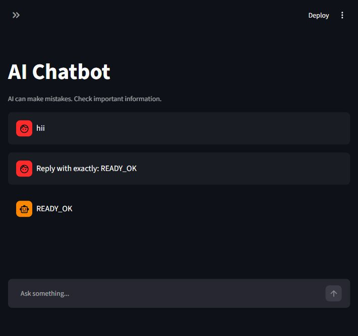
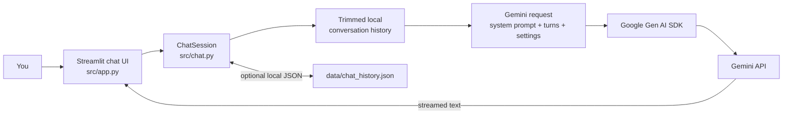
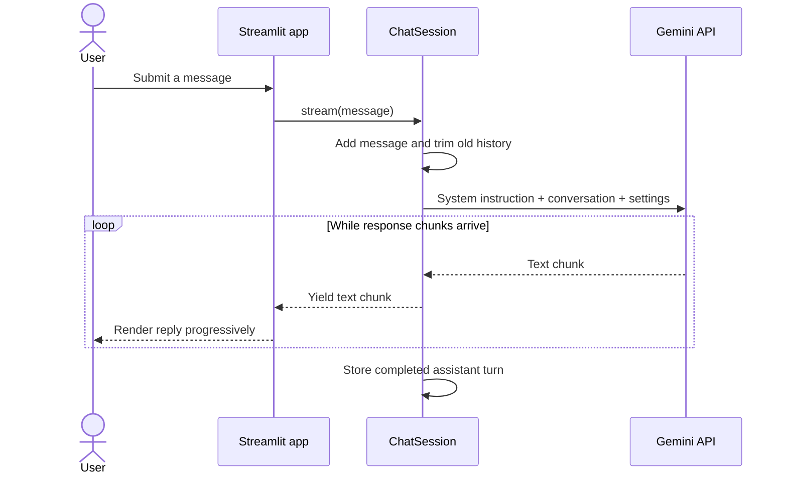
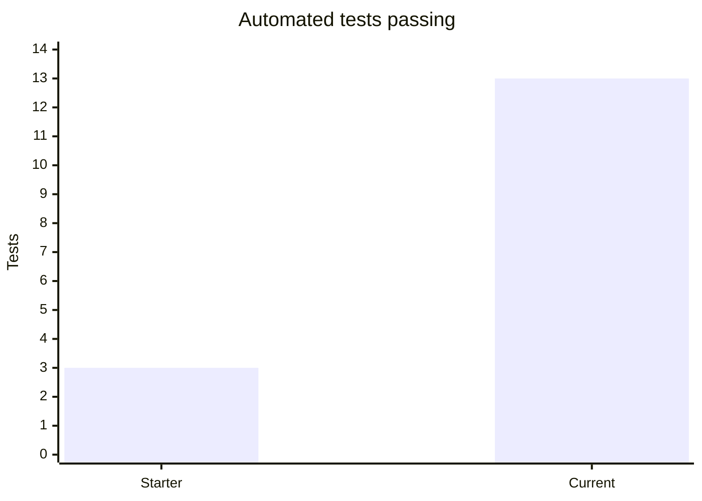
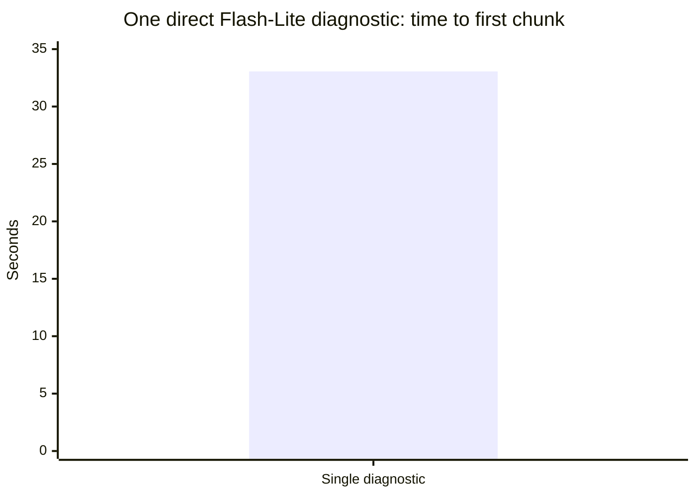

# Gemini Streamlit Chatbot

[](https://www.python.org/)
[](https://streamlit.io/)
[](https://ai.google.dev/gemini-api/docs)
[](#testing-and-evaluation)

A small, inspectable AI chat app built with Streamlit and Google Gemini. Adjust the assistant's instructions and response settings, get streamed replies with conversation context, and optionally save one conversation locally.

> **Learning project:** this is a demo, not a source of professional advice. AI replies can be wrong; verify important information.

## Preview



## What it does

- Streams Gemini replies into a simple chat interface.
- Sends the system prompt and recent conversation turns to Gemini for context.
- Lets you edit the system prompt, response token limit, and temperature in the sidebar.
- Trims older turns using a rough character-based token estimate to bound request history.
- Starts a fresh conversation, or saves and loads one conversation as local JSON.
- Retries selected temporary provider/network errors a limited number of times and displays user-safe errors.
- Keeps the API key in a local `.env` file; the key is not stored in saved chats.

## How a message travels



The UI owns presentation and controls. `ChatSession` owns the chat logic, request construction, history handling, retries, and local persistence, which keeps the core easier to test without a live API call.

## Request lifecycle



## Observed checks

### Test suite size

The starter contained 3 automated tests; the current suite contains 13. This is a count of automated checks, not an evaluation of answer quality.



### One-off provider latency diagnostic

One direct Gemini 3.5 Flash-Lite diagnostic on October 26, 2026 produced its first response chunk after 33.06 seconds. A later short UI smoke check succeeded, but its latency was not measured. These are individual observations, not a benchmark or a service-level guarantee; actual speed depends on provider availability, network, prompt, and model settings.



## Requirements

- Python 3.10 or newer
- A Google Gemini API key with access to the selected model
- Internet access when installing dependencies and when chatting with Gemini

## Quick start

### Windows PowerShell

```powershell
# From the cloned project directory
py -3 -m venv .venv
.\.venv\Scripts\Activate.ps1
python -m pip install --upgrade pip
pip install -r requirements.txt
Copy-Item .env.example .env
```

Open `.env` in a text editor and replace the placeholder with your own API key:

```dotenv
GEMINI_API_KEY=your-gemini-api-key-here
MODEL=gemini-3.5-flash-lite
THINKING_LEVEL=minimal
```

Get a key from [Google AI Studio](https://aistudio.google.com/app/apikey). Keep `.env` private and do not paste the key into source code, issues, screenshots, or commits.

Start the app:

```powershell
streamlit run src/app.py
```

Streamlit prints a local URL, usually `http://localhost:8501`.

### macOS and Linux

```bash
python3 -m venv .venv
source .venv/bin/activate
python -m pip install --upgrade pip
pip install -r requirements.txt
cp .env.example .env
```

Add your API key to `.env`, then run:

```bash
streamlit run src/app.py
```

## Configuration

| Variable | Default | Description |
|---|---|---|
| `GEMINI_API_KEY` | — | Required. Gemini API key read from the environment via `.env`. |
| `MODEL` | `gemini-3.5-flash-lite` | Gemini model identifier. Change it only to a model available to your API key. |
| `THINKING_LEVEL` | `minimal` | Gemini thinking setting sent with requests. Higher settings may increase response time. |

The app currently sets the initial response token limit and temperature in code; both can be adjusted in the sidebar for the current session. The model defaults reflect the project's local availability/latency checks and may not be optimal or available for every account.

## Using the app

1. Type a question in the message box and submit it.
2. Edit **System prompt**, **Max reply tokens**, or **Temperature** in the sidebar to change how Gemini responds.
3. Use **New conversation** to clear the current in-memory chat.
4. Use **Save conversation** to write the current chat and settings to `data/chat_history.json`; **Load saved conversation** restores it.

The saved JSON is local, unencrypted, and excluded from Git. Do not save sensitive conversations. The app sends the current message and retained conversation context to Google's Gemini API; follow Google's applicable API terms and privacy information.

## Testing and evaluation

Run the automated tests from the project root:

```bash
python -m pytest -q
```

Latest local run: **13 passed** (one third-party SDK deprecation warning). The tests use fake clients for Gemini request behavior and do not need a live API key. They cover request construction, history trimming, streaming, retries/error handling, environment-based key loading, and saved-chat validation.

A short live UI smoke check returned the expected `READY_OK` response. This confirms that one short request completed; it does not establish answer quality, multi-turn recall, or typical response speed. A fixed 10-question quality evaluation and a manual network-disconnection check remain future validation work. Detailed experiment notes are in [`docs/06_TESTING_EVALUATION.md`](docs/06_TESTING_EVALUATION.md).

## Project structure

```text
.
├── src/
│   ├── app.py               # Thin Streamlit interface
│   └── chat.py              # Chat session, Gemini calls, history, persistence
├── tests/
│   └── test_chat.py         # Automated unit tests
├── reports/
│   └── chatbot-ui.png       # App screenshot
├── data/
│   └── README.md            # Local data and persistence notes
├── docs/                    # Project brief, requirements, design, testing, risks
├── .env.example             # Safe configuration template (no real key)
├── requirements.txt
└── README.md
```

## Troubleshooting

- **Missing API key:** make sure `.env` is in the project root and contains `GEMINI_API_KEY=...`; restart Streamlit after changing it.
- **401/403 response:** check the key and confirm that the selected model is available to your account.
- **429 response:** wait briefly and retry; the API may be rate-limited or out of quota.
- **Temporary unavailable/network message:** check your connection and try again later. Selected transient failures are retried a bounded number of times.
- **Slow first reply:** model availability, provider load, network conditions, prompt size, and thinking level can all affect latency. `THINKING_LEVEL=minimal` is the default; changing models or settings can change speed and quality.
- **Could not load a saved conversation:** the local JSON may be missing or invalid. The app does not upload this file as a dataset.

## Design notes and limitations

- Conversation history is sent with each Gemini request; it is not a server-side chat session.
- History trimming uses a rough estimate of about four characters per token, not Gemini's tokenizer.
- One saved conversation is stored in local JSON. It is neither encrypted nor synchronized between devices.
- No training dataset or fixed answer-quality benchmark is used in this project.
- Gemini availability, API quotas, model identifiers, and pricing are controlled by Google and may change.

## Learning resources

- [Gemini API documentation](https://ai.google.dev/gemini-api/docs)
- [Google Gen AI Python SDK](https://googleapis.github.io/python-genai/)
- [Streamlit documentation](https://docs.streamlit.io/)

## License

No license file is currently included. Add a license before reusing or redistributing this project.
